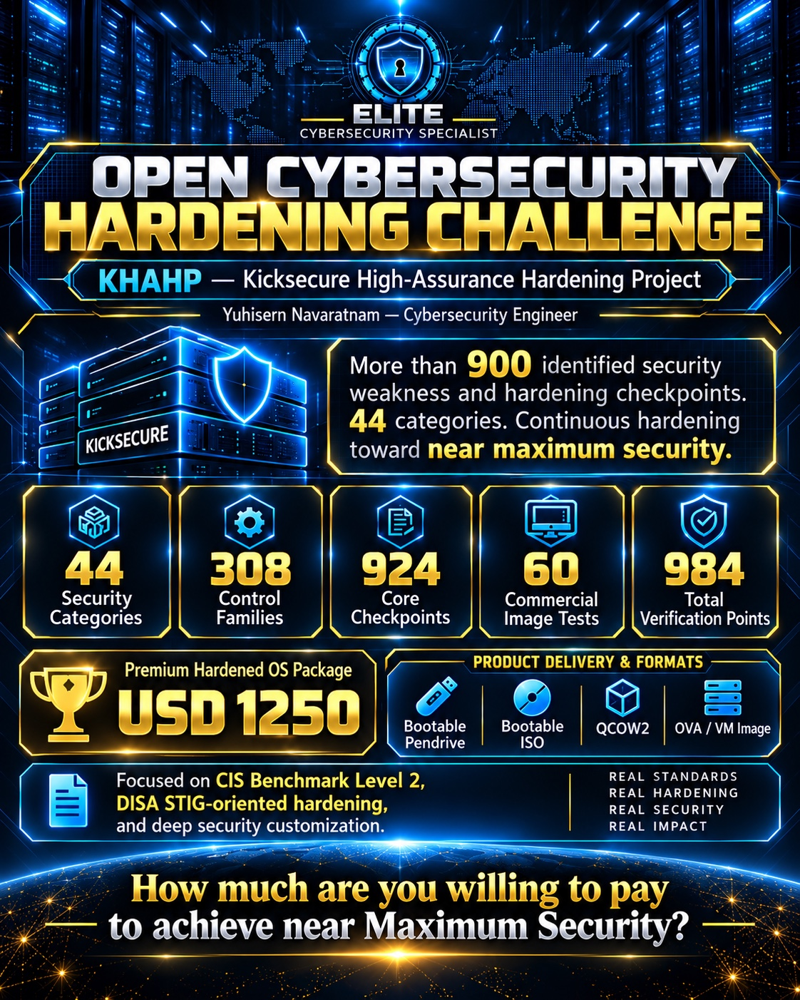
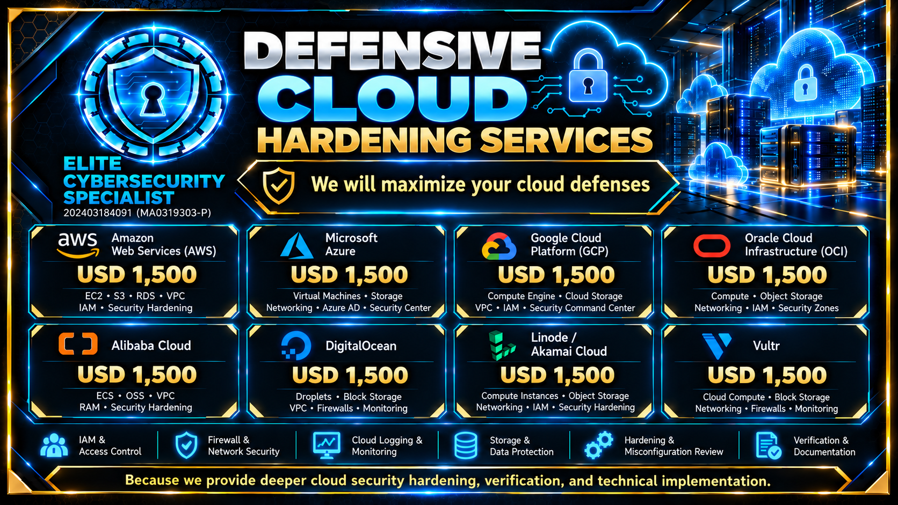

  

<h1 align="center">KHAHP · KICKSECURE HIGH-ASSURANCE HARDENING PROJECT</h1>

<strong>ROYAL HARDENING · ENGINEERING-LED DEFENCE · VERIFIABLE ASSURANCE</strong>

  <strong>ELITE CYBERSECURITY SPECIALIST · MALAYSIA</strong> 
  Beyond conventional hardening baselines · HARDEN. TEST. VERIFY. IMPROVE.

  
  
  

  
  
  

  <a href="KHAHP_FULL_TECHNICAL_REGISTER.md"><strong>FULL TECHNICAL REGISTER</strong></a>
  &nbsp;·&nbsp;
  <a href="docs/KHAHP_Public_Master_Evidence_Sections_01-44_v5.0.pdf"><strong>PUBLIC EVIDENCE PDF</strong></a>
  &nbsp;·&nbsp;
  <a href="https://elite-cybersecurity-specialist.blogspot.com/2026/10/khahp-kicksecure-high-assurance.html"><strong>PROJECT ARTICLE</strong></a>
  &nbsp;·&nbsp;
  <a href="https://github.com/elite-cybersecurity-specialist/company-profile"><strong>COMPANY PROFILE</strong></a>
  &nbsp;·&nbsp;
  <a href="mailto:Yuhisern@protonmail.com"><strong>CONTACT ECS</strong></a>

---

> [!IMPORTANT]
> **The challenge: demonstrate the defence.** This project documents real defensive controls with provenance, role-appropriate enforcement, persistence and recovery. Its **924 assurance checkpoints are not 924 vulnerabilities**. The accepted figure is an **owner/project engineering milestone**, not third-party CIS, DISA or KSPP certification.

## Explore the engineering

| **44 security domains** | **308 control families** | **924 A/B/C gates** | **840 project-accepted** |
|:---:|:---:|:---:|:---:|
| Full technical scope | Seven families per domain | Three assurance dimensions per family | Sections 01–40 |

| Begin here | Explore |
|---|---|
| **[The 44-domain security atlas](#the-44-domain-security-atlas)** | Understand the entire architecture from platform trust to final assurance. |
| **[Full technical register](KHAHP_FULL_TECHNICAL_REGISTER.md)** | Inspect every domain, all 308 control families and 924 gate identifiers. |
| **[Engineering methodology](#the-khahp-engineering-method)** | See how provenance, runtime enforcement and persistence are assessed. |
| **[Defensive engineering outcomes](#demonstrated-defensive-engineering)** | Review the accepted security disciplines and real implementation work. |
| **[Current program position](#program-progress--44-sections-and-924-checkpoints)** | Understand acceptance, Section 41 review and the remaining work. |
| **[Evidence and publication](#full-technical-documentation-and-evidence)** | Read the public register and portable evidence publication. |

---

## Contents

- [About KHAHP and Royal Hardening](#about-khahp-and-royal-hardening)
- [The KHAHP Engineering Method](#the-khahp-engineering-method)
- [Program Progress — 44 Sections and 924 Checkpoints](#program-progress--44-sections-and-924-checkpoints)
- [The 44-domain security atlas](#the-44-domain-security-atlas)
- [Demonstrated Defensive Engineering](#demonstrated-defensive-engineering)
- [Section 40 Final Closeout — auditd and AIDE](#section-40-final-closeout--auditd-and-aide)
- [Remaining Engineering — Sections 41–44](#remaining-engineering--sections-4144)
- [Defensive Hardening Services and Supported Platforms](#defensive-hardening-services-and-supported-platforms)
- [Security Frameworks and Compliance Engineering](#security-frameworks-and-compliance-engineering)
- [Full Technical Documentation and Evidence](#full-technical-documentation-and-evidence)
- [Planned Premium Kicksecure Hardened OS](#planned-premium-kicksecure-hardened-os)
- [Open Challenge and Responsible Publication](#open-challenge-and-responsible-publication)
- [Connect with Elite Cybersecurity Specialist](#connect-with-elite-cybersecurity-specialist)

---

## About KHAHP and Royal Hardening

**KHAHP — Kicksecure High-Assurance Hardening Project** is ELITE CYBERSECURITY SPECIALIST's public high-assurance defensive hardening and verification reference implementation for a **Kicksecure / Debian 13 laptop**.

**Kicksecure OS Royal Hardening details are revealed publicly as an example of the quality, depth and evidence discipline behind our defensive cybersecurity work.** We publish the engineering structure, hardening domains, implementation decisions and sanitized technical evidence so customers, researchers and security professionals can evaluate the work itself.

**200+ HOURS OF HANDS-ON HARDENING AND SECURITY VERIFICATION (OWNER-REPORTED)**

Our objective is not to apply a generic checklist blindly. It is to **reduce attack surface, strengthen relevant security controls, test enforcement, prove persistence and maintain a recoverable system** while respecting hardware, software and operating-role compatibility.

> [!NOTE]
> **DEFENSE IN DEPTH — BEYOND ONE SECURITY PRODUCT**  
> A hardened environment is the combined result of secure boot and encrypted storage, least privilege, kernel and filesystem controls, network/DNS/firewall policy, device restrictions, application privacy, monitoring, integrity verification and controlled recovery.

---

## The KHAHP Engineering Method

The company's customer-facing security lifecycle is:

<strong>HARDEN → TEST → VALIDATE → REMEDIATE → RE-TEST → MAINTAIN</strong>

KHAHP's implementation decisions additionally follow an evidence-led engineering process:

| Engineering stage | Purpose |
|---|---|
| **1. Establish provenance and baseline** | Identify the responsible package, vendor control, configuration and expected system behavior. |
| **2. Define requirement and compatibility** | Distinguish security defects, hardening enhancements, inherited protections and accepted policy decisions. |
| **3. Design controlled changes** | Maintain a rollback/recovery route before approved configuration changes. |
| **4. Verify enforcement** | Use bounded positive and negative tests in the correct operating context. |
| **5. Confirm persistence** | Verify relevant reboot, update, reconnect or recovery behavior. |
| **6. Record acceptance** | Link evidence to the exact control family and A/B/C checkpoints in the authoritative register. |

### USER and SYSMAINT — protected operating roles

| Operating role | Security purpose |
|---|---|
| **USER** | Normal restricted desktop environment with no routine elevation of administrative privileges. |
| **SYSMAINT** | Physically selected, separate privileged maintenance boot with explicit boot-role validation and controlled changes. |

> [!IMPORTANT]
> **Preserve role separation.** USER and SYSMAINT are intentionally different operating contexts. An observation in one context must not be mislabeled a defect in the other without checking the project's intended role-specific behavior.

---

## Program Progress — 44 Sections and 924 Checkpoints

  

  

  

| Workstream | Recorded progress | Milestone |
|---|---:|---|
| **Reconnaissance / security review** | **40 / 44 · 90.9%** | Sections 01–40 completed |
| **Hardening implementation** | **40 / 44 · 90.9%** | Sections 01–40 project-complete |
| **A/B/C assurance** | **840 / 924 · 90.9%** | 840 checkpoints project-accepted |
| **Remaining work** | **4 sections · 84 checkpoints** | Sections 41–44 |

### Current program position

| Section range | Gates | Current engineering position |
|---|---:|---|
| **01–40** | **840** | **PROJECT_ACCEPTED** — established owner/project baseline |
| **41 — Persistence / supply chain** | **21** | **REVIEW_REQUIRED** — evidence reconciliation and owner decisions remain |
| **42 — Credentials / recovery** | **21** | **NOT_ASSESSED** — verification toolkit is not target-machine acceptance |
| **43–44 — Framework mapping / final assurance** | **42** | **PLANNED** — rule-level assessment, regression and sign-off |
| **TOTAL** | **924** | **840 project-accepted; 84 not yet accepted** |

The newer internal engineering program is maintained separately from the public **v5.0 register and evidence PDF**. Public-facing figures above reflect the current recorded owner/project acceptance boundary; no private machine records or release secrets are published here.

### What the 924 checkpoints mean

The program contains **44 security sections**, each with **7 technical control families**:

**44 sections × 7 control families = 308 families**  
**308 control families × 3 assurance gates = 924 checkpoints**

| Gate | Assurance requirement |
|---|---|
| **A — Provenance / configuration** | Approved source, package/file ownership, intended control, accepted policy or exception. |
| **B — Effective enforcement** | Role-specific runtime behavior, bounded allow/deny evidence or accepted applicability. |
| **C — Persistence / recovery** | Reboot, reconnect, update or recovery behavior, or an approved project disposition. |

> [!NOTE]
> **924 checkpoints are not 924 vulnerabilities.** A checkpoint may verify an existing Kicksecure/Debian safeguard, demonstrate an additional KHAHP hardening measure, record a deliberate compatibility decision or prove lifecycle behavior.

### Current milestone — Sections 01–40 complete

Under the 19 October 2026 v5.0 project register, **Sections 01–40 are closed with no outstanding implementation gaps in the accepted baseline**. All associated 840 checkpoints are recorded as **`PROJECT_ACCEPTED`**. Acceptance covers implemented, satisfied, accepted-design, compatibility/policy and inapplicable dispositions within scope.

**Section 39 — BIOS/firmware:** owner-complete / no retest unless deliberately reopened or affected by material change.  
**Section 40 — auditd/AIDE:** final evidence accepted, including the effective USER-mode audit-rule state and successful production integrity check.

Material changes—including significant package, kernel, policy, firmware, hardware or image-release changes—can require relevant regression tests without resetting the historical acceptance record.

---

## The 44-domain security atlas

Every domain below has **seven control families** and **21 A/B/C assurance checkpoints**. The [public technical register](KHAHP_FULL_TECHNICAL_REGISTER.md) identifies every control family and all **924 unique gate identifiers**, including domains not yet accepted.

<strong>01–14 · PLATFORM & ROOT OF TRUST</strong> · 14 engineering domains

| No. | Security engineering domain |
|:---:|---|
| **01** | Platform / OS / Hardware Baseline |
| **02** | Kicksecure Package Provenance |
| **03** | USER / SYSMAINT Privilege Architecture |
| **04** | SYSMAINT Boot Role |
| **05** | Accounts / UID / GID / Local Identity |
| **06** | LUKS / Disk / Swap Encryption |
| **07** | Filesystem / Mount Security |
| **08** | GRUB / Bootloader Protection |
| **09** | CPU Vulnerability Mitigations |
| **10** | IOMMU / DMA Protection |
| **11** | Kernel Sysctl Hardening |
| **12** | Kernel Boot / Memory Hardening |
| **13** | Kernel Module Restrictions |
| **14** | Kernel Module Signing / DKMS |

<strong>15–25 · HOST DEFENCES & IDENTITY</strong> · 11 engineering domains

| No. | Security engineering domain |
|:---:|---|
| **15** | AppArmor / Mandatory Access Control |
| **16** | SUID / SGID / File Capabilities |
| **17** | Permissions / ACL / Umask |
| **18** | PAM / Login / Faillock |
| **19** | SSH Client / Server Security |
| **20** | Enabled / Running Service Audit |
| **21** | systemd Service Sandboxing |
| **22** | System.map / Core Dumps / PStore |
| **23** | Journald / Logging / Logrotate |
| **24** | Panic / Recovery / Emergency Shutdown |
| **25** | RAM Wipe |

<strong>26–34 · NETWORK, PERIPHERALS & ISOLATION</strong> · 9 engineering domains

| No. | Security engineering domain |
|:---:|---|
| **26** | USBGuard / Peripheral Security |
| **27** | NetworkManager / Wi-Fi / MAC / DHCP |
| **28** | IPv6 Policy |
| **29** | Unbound / Local DNS Architecture |
| **30** | DNSSEC / DoT / DNS Leak Prevention |
| **31** | nftables Firewall |
| **32** | LAN Discovery / Multicast / LLMNR / mDNS |
| **33** | Tor / SOCKS / DNS Isolation |
| **34** | sdwdate / Secure Time / Boot Clock |

<strong>35–44 · PRIVACY, INTEGRITY & ASSURANCE</strong> · 10 engineering domains

| No. | Security engineering domain |
|:---:|---|
| **35** | Entropy / RNG |
| **36** | Browser DoH / WebRTC / Telemetry |
| **37** | Application / File / Metadata Privacy |
| **38** | Camera / Microphone / Power / Screen Lock |
| **39** | Firmware / BIOS / Secure Boot / TPM |
| **40** | Auditd / AIDE / Integrity Monitoring |
| **41** | Cron / Timers / Persistence / Supply Chain |
| **42** | Credentials / SSH Keys / Secrets / Backup |
| **43** | CIS / DISA GPOS / KSPP Mapping |
| **44** | Final Acceptance / Evidence / Scoring |

<a href="KHAHP_FULL_TECHNICAL_REGISTER.md"><strong>EXPLORE THE COMPLETE 44-SECTION / 308-FAMILY / 924-GATE TECHNICAL REGISTER</strong></a>

---

## Demonstrated Defensive Engineering

The following table summarizes existing **project-accepted technical outcomes**, not merely proposed features.

| Defensive domain | Accepted engineering position |
|---|---|
| **Privilege separation** | Distinct USER desktop and privileged SYSMAINT maintenance roles, with intended limitations retained. |
| **Kernel / memory hardening** | Restricted kernel pointers, `dmesg`, `ptrace`, unprivileged BPF and hardened boot/memory parameters. |
| **Boot / encrypted storage** | LUKS root, Secure Boot evidence, signed DKMS evidence and corrected `/boot` → `/boot/efi` mount ordering. |
| **Filesystem protections** | `/tmp` `nodev,nosuid`; blanket `noexec` handled through the explicit owner-approved compatibility disposition. |
| **DNS and encrypted resolution** | Local Unbound resolver, DNSSEC, authenticated DoT architecture and DNS-egress policy. |
| **Network and firewall security** | `nftables` filtering, Tor/SOCKS routing policy and relevant service-discovery restrictions. |
| **Device and privacy controls** | USBGuard owner policy, USER camera/microphone denial, Bluetooth block and desktop privacy controls. |
| **Browser / application privacy** | Firefox privacy restrictions, seccomp observations and thumbnail-generation hardening. |
| **Monitoring and integrity** | Effective `auditd` rules in normal USER boot and successful scheduled production AIDE verification. |

> [!IMPORTANT]
> **Security is verified, not assumed.** The authoritative technical register distinguishes inherited protections, observed state, implemented changes, compatibility decisions and documented acceptance.

---

## Section 40 Final Closeout — auditd and AIDE

Section 40 was accepted with final evidence captured on **19 October 2026**:

- `auditd.service` was **enabled, active and running** in normal USER boot.
- The kernel audit subsystem had a live auditd PID; the acceptance capture reported **zero lost audit records**.
- Persistent KHAHP audit rules compiled and were **effectively loaded** in normal USER boot.
- The earlier SYSMAINT `auditctl -l: No rules` observation was correctly classified as **boot-role behavior**, since auditd is inactive in SYSMAINT.
- The persistent `/usr/bin/dotlockfile` permissions issue was repaired to **`755 root:mail`**.
- A controlled production `dailyaidecheck.service` run succeeded with **`ExecMainStatus=0`**.
- The `dailyaidecheck.timer` remained enabled as part of the integrity-monitoring baseline.

**All 21 Section 40 A/B/C checkpoints are project-accepted.** External mail notification and audit immutability retain their recorded policy/operational dispositions.

---

## Remaining Engineering — Sections 41–44

The remaining work is defined in the 44-section technical register. The listed scopes are engineering requirements, not newly accepted results. Section 41 has evidence under review; the remaining sections require their own assessment and acceptance.

| Section | Seven technical control families | Gates | Current position |
|---|---|---:|---|
| **41 — Cron / Timers / Persistence / Supply Chain** | Cron/anacron jobs; systemd timers; desktop/user autostart; repository and signing-key provenance; APT pinning/holds; unexpected startup scripts/services/modules; reboot and supply-chain drift evidence. | **21** | Review required |
| **42 — Credentials / SSH Keys / Secrets / Backup** | SSH private keys; token/secret storage; password-manager policy; FIDO2/YubiKey readiness; offline recovery-code handling; encrypted backups; isolated restore/disaster recovery. | **21** | Not assessed |
| **43 — CIS / DISA GPOS / KSPP Mapping** | CIS Debian 13 L2 mapping; DISA GPOS/SRG mapping; KSPP alignment; Kicksecure-native equivalents; KHAHP extensions; exceptions/N-A rationale; evidence citations. | **21** | Planned |
| **44 — Final Acceptance / Evidence / Scoring** | Reboot persistence; USER regression; SYSMAINT regression; network/DNS/firewall/Tor/USB negative tests; rollback and recovery; evidence hashes/chain of custody; final scorecard/sign-off. | **21** | Planned |
| **TOTAL REMAINING** | **28 control families** | **84** | Not accepted |

> [!NOTE]
> **CONTINUATION BOUNDARY**  
> Sections **01–40** remain accepted in the current baseline. Section **41** is under engineering review; Sections **42–44** remain subject to further assessment and acceptance. Future acceptance requires actual role-appropriate evidence and controlled recovery testing.

---

## Defensive Hardening Services and Supported Platforms

KHAHP is our **public Kicksecure reference implementation**. ECS applies the same evidence-led method to other supported technologies, selecting implementation and verification for the real environment rather than assuming identical settings on every platform.

  

| Platform / service | Engineering coverage |
|---|---|
| **Kicksecure OS** | **Royal Hardening — public technical reference implementation** |
| **Ubuntu / Debian Linux** | Server and workstation hardening |
| **RHEL / Rocky Linux / AlmaLinux / CentOS Stream** | Enterprise Linux hardening |
| **Windows Server / enterprise workstations** | Windows defensive hardening |
| **AWS / Azure / Google Cloud / Oracle Cloud** | Cloud security hardening |
| **VMware ESXi / Proxmox VE** | Virtualization and hypervisor hardening |
| **Supported managed endpoints / devices** | Vendor-capability-based hardening and lifecycle review |

  

**Each customer receives an individually scoped engineering process**, including platform-specific compatibility checks, suitable change control and documented verification. The Kicksecure demonstration does not automatically establish the security state of other operating systems or customer deployments.

---

## Security Frameworks and Compliance Engineering

KHAHP builds on Kicksecure and Debian 13 and draws engineering requirements from established high-security references.

| Framework / reference | How KHAHP uses it |
|---|---|
| **CIS Debian Linux Level 2** | Applicable system-hardening recommendations and configuration-control objectives. |
| **DISA General Purpose OS SRG / applicable STIG principles** | High-security operating-system, identity, auditing and integrity objectives, adapted to the platform. |
| **Kernel Self Protection Project (KSPP)** | Kernel build, boot-time, runtime and exploit-mitigation guidance as applicable. |
| **Kicksecure / Debian security architecture** | Preserve and verify relevant inherited protections and correct package provenance. |
| **KHAHP project extensions** | Additional high-assurance control families, role-aware verification and recovery evidence. |

**Section 43 is the dedicated control-by-control framework-mapping phase.** The project distinguishes framework alignment and owner acceptance from formal assessment by an external certification authority.

> [!IMPORTANT]
> **ENGINEERING ALIGNMENT AND CERTIFICATION ARE DIFFERENT THINGS.**  
> KHAHP's accepted checkpoint record is a project/owner engineering assessment. It is **not presented as third-party CIS, DISA or KSPP certification**.

---

## Full Technical Documentation and Evidence

The public register preserves all **44 sections**, **308 control families**, **924 A/B/C evidence identifiers**, relevant project dispositions and the remaining continuation roadmap.

| Document | What it contains |
|---|---|
| **[Full 44-Section Technical Register — v5.0](KHAHP_FULL_TECHNICAL_REGISTER.md)** | Detailed control-family descriptions; A/B/C identifiers; Sections 01–40 acceptance and Sections 41–44 roadmap; 63 historical action records closed for traceability. |
| **[Public Master Technical Evidence — v5.0 (PDF)](docs/KHAHP_Public_Master_Evidence_Sections_01-44_v5.0.pdf)** | Portable public technical register and summarized evidence publication. |

The underlying private master, authoritative gate ledger, sensitive host evidence and engineering operations material are kept separate from the public repository. Raw private audit history, credentials, private keys, recovery material, confidential device identifiers and internal host-specific security data are not disclosed here.

---

## Planned Premium Kicksecure Hardened OS

**Target price: USD $1,250.** Planned distribution formats include:

| Format | Release-engineering focus |
|---|---|
| **Physical ISO / USB** | Fresh installation, hardware boot, disk encryption, Secure Boot and recoverability. |
| **KVM / QCOW2** | Clean import, virtual platform compatibility, unique identity and recovery. |
| **VirtualBox / OVA** | Safe import defaults, clone sanitation and supported host integration. |

> [!NOTE]
> **PLANNED COMMERCIAL RELEASE — NOT YET PUBLISHED**  
> The intended premium image is a separate release-engineering workstream. A distributable build requires clean sources, unique machine identities and host keys, artifact signing, documented licensing, platform regression and final recovery acceptance.

---

## Open Challenge and Responsible Publication

**The challenge:** Demonstrate a reproducible hardening implementation with a clear threat model, approved scope, defensible package/configuration provenance, before-and-after evidence, effective security tests, reboot persistence, rollback/recovery and a verifiable evidence trail.

| Evidence expected | Why it matters |
|---|---|
| **Provenance and baseline** | Establish what the system already protects and which component supplies the control. |
| **Runtime validation** | Demonstrate that intended restrictions actually operate in the proper role. |
| **Negative tests and boundaries** | Verify denied behaviors without damaging the operating system or a third-party environment. |
| **Persistence and recovery** | Show that the security state survives relevant lifecycle events and can be safely recovered. |
| **Reproducible documentation** | Permit technically meaningful review while sanitizing confidential information. |

**Responsible disclosure:** Do not publish personal device identifiers, passwords, private keys, private rulesets, confidential IP/MAC data, backup locations, sensitive vulnerability details or recovery secrets. Credit existing Kicksecure/Debian protections accurately and distinguish them from KHAHP changes.

---

## Connect with Elite Cybersecurity Specialist

**Yuhisern Navaratnam** — Cybersecurity Engineer  
**Elite Cybersecurity Specialist** | Malaysia  
**SSM:** 202403184091 (MA0319303-P)

**Email:** [Yuhisern@protonmail.com](mailto:Yuhisern@protonmail.com) 
**WhatsApp:** [+60 17-279 1717](https://wa.me/60172791717) 
**GitHub — Company Profile:** [Official repository](https://github.com/elite-cybersecurity-specialist/company-profile) 
**GitHub — Hardening Challenge:** [Official repository](https://github.com/elite-cybersecurity-specialist/hardening-challenge) 
**GitHub — Battle-Hardened AI:** [Official repository](https://github.com/elite-cybersecurity-specialist/battle-hardened-ai) 
**GitHub — Other Cybersecurity Projects:** [Elite Cybersecurity Specialist](https://github.com/elite-cybersecurity-specialist) 
**TikTok:** [@yuhisern](https://www.tiktok.com/@yuhisern) 
**LinkedIn:** [linkedin.com/in/yuhisern](https://www.linkedin.com/in/yuhisern) 
**X:** [x.com/yuhisern](https://x.com/yuhisern) 
**LinkedIn — ECS Company:** [Elite Cybersecurity Specialist](https://www.linkedin.com/company/elite-cybersecurity-specialist/) 
**Official ECS Blog:** [ECS Cybersecurity Articles](https://elite-cybersecurity-specialist.blogspot.com)

**Company Profile:** [Download the ECS Company Profile (PDF)](https://github.com/elite-cybersecurity-specialist/company-profile/raw/refs/heads/main/pdf/ECS_Company_Profile.pdf)

<strong>HARDEN. TEST. VERIFY. IMPROVE.</strong>

<em>Security Engineering · Defensive Hardening · Evidence-Led Verification · Continuous Improvement</em>

KHAHP public engineering reference · v5.0 evidence register · 40/44 sections and 840/924 gates project-accepted · ELITE CYBERSECURITY SPECIALIST, MALAYSIA.

