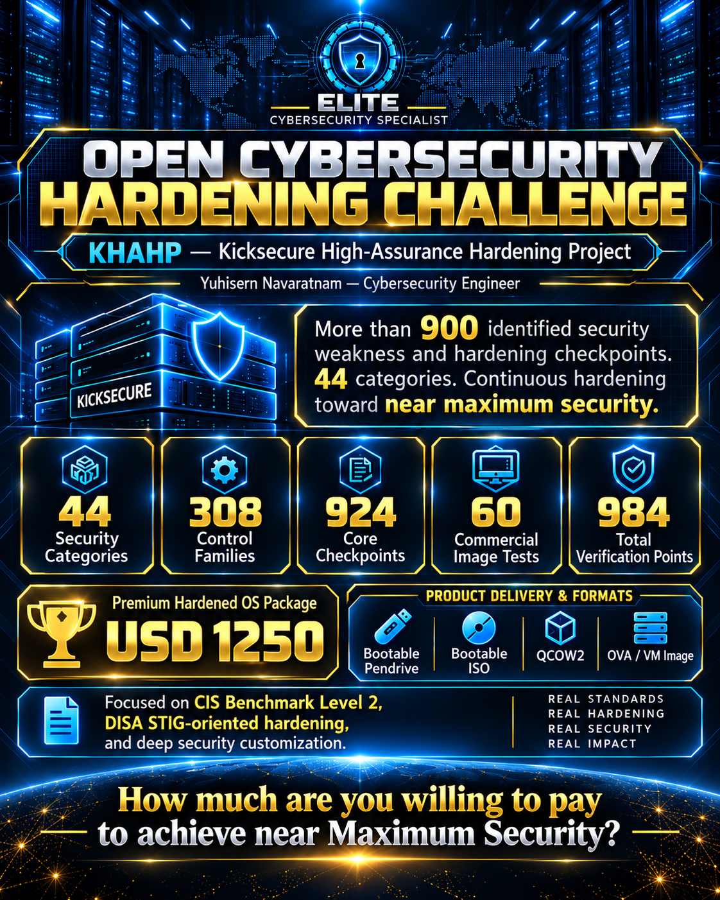

# KHAHP — Kicksecure High-Assurance Hardening Project

### Open Cybersecurity Hardening Challenge

**ELITE CYBERSECURITY SPECIALIST** · Malaysia  
**Yuhisern Navaratnam** · Cybersecurity Engineer · Founder & Project Architect  
**Over 120 hours of engineering and counting**

> **Can you demonstrate a stronger, better-verified Kicksecure hardening result?**

KHAHP is an ongoing, evidence-driven effort to identify security weaknesses, attack-surface exposures, missing safeguards and hardening opportunities in a Kicksecure-based system, then strengthen, test, and maintain the applicable protections. The project publishes a **44-category technical roadmap** to invite independently reproducible security comparisons.

## Project scope

| Scope | Defined items |
|:--|--:|
| Parent security categories | **44** |
| Technical control families | **308** |
| Core A/B/C checkpoints | **924** |
| Proposed commercial image-release tests | **60** |
| **Total verification scope** | **984** |

The program covers **900+ identified security-weakness and hardening checkpoints**. The 924 core checkpoints are not 924 confirmed exploitable vulnerabilities or 924 completed patches. Every control is evaluated for **A — configuration/provenance**, **B — runtime enforcement**, and **C — persistence, negative testing or recovery**. The objective is to remediate real weaknesses and close all applicable checkpoints with evidence or justified exceptions.

**Project status:** Archived reconnaissance and family-level evidence review completed. **Staged hardening and final acceptance remain in progress.** No completed independent certification or released commercial image is claimed.

## Why Kicksecure?

[Kicksecure](https://www.kicksecure.com/) is a Debian-derived, security-focused operating system built to reduce attack surfaces and support stronger-than-default defensive practices. It provides a foundation for:

- Separation of restricted day-to-day **USER** operation from **SYSMAINT** administration.
- Linux kernel and application hardening, including AppArmor confinement.
- Service minimization, restrictive networking, auditing and file-integrity monitoring.
- Privacy-conscious operation and integration with more demanding network-security policies.
- Reproducible verification, long-term maintenance and controlled recovery.

Kicksecure is **not a guarantee of anonymity** or immunity from compromise. Privacy routing, operational security, firmware capabilities and ongoing updates remain part of the threat model.

## Who is the project intended to support?

High-sensitivity use cases such as authorized law-enforcement investigations, government operations, investigative journalism and source protection, senior public officials, sensitive financial operations, critical infrastructure and executive endpoints. Actual use in classified or regulated environments requires the organization’s own authorization, policies and assessment.

## The open challenge

We invite cybersecurity specialists, system-hardening researchers, operating-system engineers, red and blue teams, and high-assurance reviewers to demonstrate **stronger protections backed by better evidence**.

A convincing submission should include:

1. A clear threat model, operating-system and package versions, and test environment.
2. Actual attack-surface reduction and least-privilege policy—not just configuration screenshots.
3. Runtime enforcement and authorized negative tests.
4. Reboot/upgrade persistence, failure handling, and tested recovery.
5. Transparent exceptions, compatibility costs, and independently inspectable artifacts.

This is an **open technical challenge**, not a claim that KHAHP has achieved a certified world record or surpassed every alternative hardened system.

## Standards and engineering approach

The work draws on **CIS Debian Linux 13 Benchmark Level 2 Workstation**, historical STIG-oriented benchmark material, relevant **DISA GPOS SRG** security objectives and **KSPP** kernel-self-protection principles. Benchmark references guide a platform-specific assessment; they do **not** imply official DISA certification or universal CIS compliance.

The engineering lifecycle is **Harden → Test → Validate → Remediate → Re-test → Maintain**.

## Staged implementation plan

| Stage | Implementation workstream | Categories |
|:--|:--|:--|
| **S0** | Safety, rollback, backups and controlled change | Prerequisite |
| **S1** | AppArmor, exposed permissions, application/metadata privacy | 15, 17, 37 |
| **S2** | Disk encryption, boot chain, kernel, memory, firmware | 06–14, 24–25, 39 |
| **S3** | Identity, privileges, system services, authentication, peripherals | 01–05, 16, 18–23, 26, 38 |
| **S4** | Wi-Fi, DNS, firewall, Tor, browser privacy and leak controls | 27–36 |
| **S5** | Audit logs, integrity monitoring and persistence | 40–41 |
| **S6** | Credentials, secrets, encrypted backup and full restore | 42 |
| **S7** | CIS / STIG-oriented / KSPP evidence and exceptions | 43 |
| **S8** | Regression testing, final acceptance and sign-off | 44 |
| **R0–R3** | Clean-image common, physical ISO, KVM and VirtualBox release tests | 60 additional tests |

**Current highest-priority candidates** include the historical world-writable `setup-dist` directory finding (17), USER application/AppArmor confinement gaps (15/37), firmware limitations (39), USBGuard effectiveness (26), and USER DNS/firewall negative tests (30/31). These findings require current-state confirmation before changes.

The [full technical register](KHAHP_FULL_TECHNICAL_REGISTER.md) contains **all 44 categories, 308 named control families, 924 core checkpoint IDs and 60 proposed release tests**, including original source-report filenames, historical evidence and implementation actions.

## Planned KHAHP Premium Hardened OS — USD 1,250

**The proposed price is USD $1,250; commercial deployment has not yet been released or accepted.** The planned editions are:

| Edition | Format | Intended deployment |
|:--|:--|:--|
| Physical | **Bootable ISO / USB pendrive** | Compatible laptops and desktops |
| KVM | **QCOW2** | QEMU/KVM virtual machines |
| VirtualBox | **OVA** | VirtualBox appliances |

Each target needs independent fresh-install, first-boot identity generation, encryption and recovery testing. The commercial artifacts must be created from a clean and version-controlled build—**never by cloning the development laptop**. No developer keys, Wi-Fi profiles, SSH host keys or disk-recovery secrets should be included.

## Repository files

- [`KHAHP_FULL_TECHNICAL_REGISTER.md`](KHAHP_FULL_TECHNICAL_REGISTER.md) — full source-derived 984-check implementation reference.
- [`assets/open-hardening-challenge.png`](assets/open-hardening-challenge.png) — promotional graphic extracted from the attached project PDF.
- [`assets/`](assets/) — additional public-facing visual assets.

> **Publication safety:** Do not upload live credentials, keys, sensitive system inventories, private network configurations, identifying host metadata, or unredacted operational reports. Publish only sanitized evidence that you have reviewed.

## Project author and contact

**Yuhisern Navaratnam**  
Cybersecurity Engineer · Founder & Project Architect  
**ELITE CYBERSECURITY SPECIALIST**  
Malaysia · Business registration **202403184091 (MA0319303-P)**  
**TikTok:** [@Yuhisern](https://www.tiktok.com/@Yuhisern)

---

### How much are you willing to pay to achieve near maximum security?

**License / reuse terms:** To be published by the project owner. Kicksecure and third-party components retain their own licenses and trademarks. Do not assume this repository grants a license until its terms are explicitly added.
