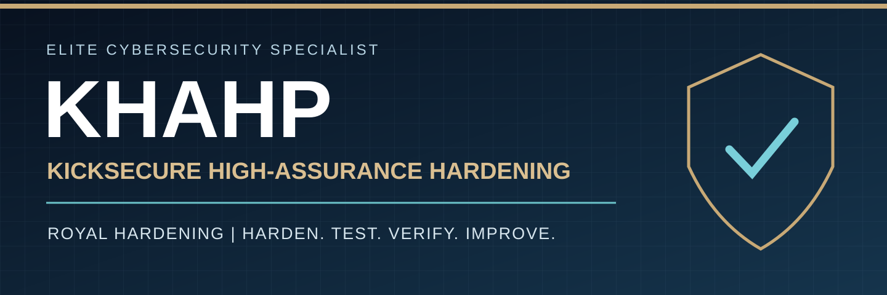
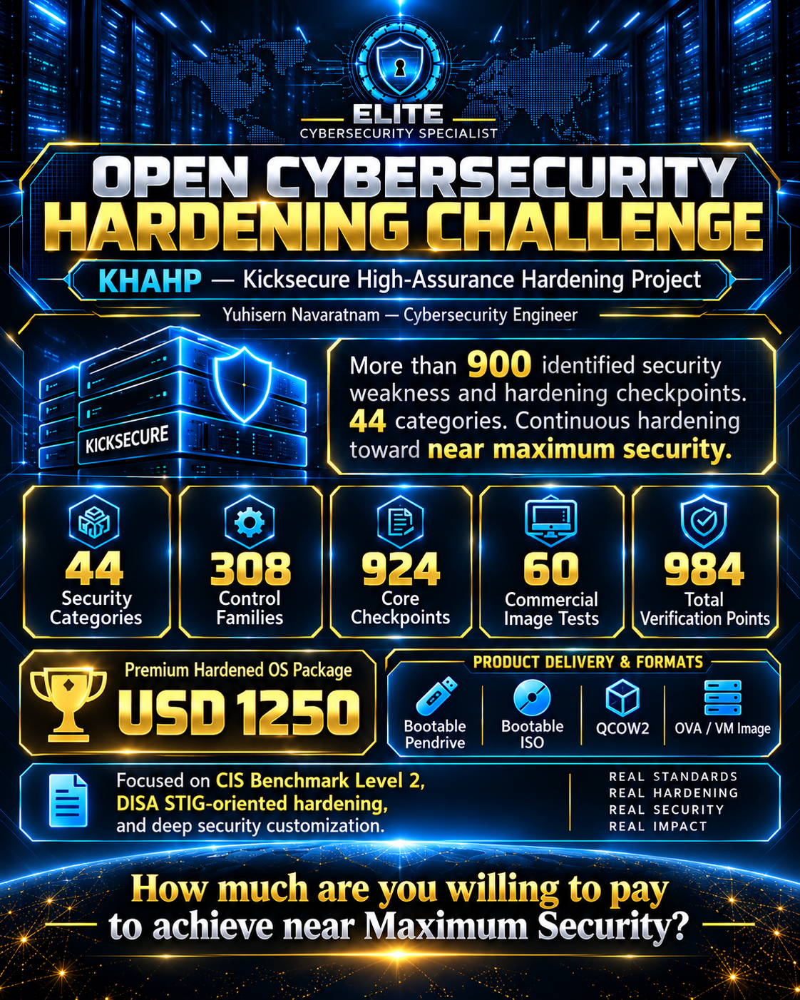

<h1 align="center">KHAHP — KICKSECURE HIGH-ASSURANCE HARDENING PROJECT</h1>

<strong>Royal Hardening · Defensive Engineering · Reproducible Assurance</strong>

<strong>ELITE CYBERSECURITY SPECIALIST · MALAYSIA</strong>

HARDEN. TEST. VERIFY. IMPROVE.

<strong>350+ HOURS OF HANDS-ON HARDENING, TESTING &amp; VERIFICATION (OWNER-REPORTED)</strong>

<a href="KHAHP_FULL_TECHNICAL_REGISTER.md"><strong>COMPLETE TECHNICAL REGISTER</strong></a> ·
<a href="docs/PUBLICATIONS.md"><strong>PUBLICATIONS</strong></a> ·
<a href="https://elite-cybersecurity-specialist.blogspot.com/2026/10/khahp-kicksecure-high-assurance.html"><strong>PROJECT ARTICLE</strong></a> ·
<a href="https://github.com/elite-cybersecurity-specialist/company-profile"><strong>COMPANY PROFILE</strong></a> ·
<a href="mailto:Yuhisern@protonmail.com"><strong>CONTACT ECS</strong></a>

---

> [!IMPORTANT]
> **THE OPEN HARDENING CHALLENGE** — Can your defensive security engineering demonstrate deeper, more reproducible protection with actual enforcement, bounded negative tests, persistence and safe recovery? **Show the engineering, its evidence and its limitations.**
>
> KHAHP's **924 checkpoints are not 924 vulnerabilities**. Current acceptance is an **owner/project** assessment, not third-party CIS, DISA or KSPP certification.

## The mission

**KHAHP** is Elite Cybersecurity Specialist's advanced defensive hardening and verification reference project for **Kicksecure / Debian 13**. Its purpose is to reduce attack surface, preserve upstream protections, strengthen isolation where appropriate and demonstrate how security controls perform across system operation, change and recovery.

The engineering program is organized around **44 domains**, each with **7 named control families** and **3 assurance gates**. Its documentation is designed for technical inspection, not merely a promotional checklist.

| PROGRAM ARCHITECTURE | ASSURANCE METHOD |
|---|---|
| **44** security domains | **A — Provenance, source configuration and approved policy** |
| **308** technical control families | **B — Role-specific runtime enforcement** |
| **924** uniquely identified checkpoints | **C — Lifecycle persistence, rollback and recovery** |

**More than 350 hours of hands-on effort (owner-reported)** underpin this engineering program, including systematic investigation, controlled hardening decisions, corrective action, cross-boot observations, technical reconciliation and evidence documentation. The accepted Sections 01–40 record work completed against the project's applicable requirements; each A/B/C gate is an assurance checkpoint, not necessarily a defect requiring a patch.

### Documented corrective engineering

The historical public evidence register preserves concrete engineering outcomes, including **`/tmp` mount-policy hardening**, a corrected **`/boot` / `/boot/efi` mount-order decision**, **desktop thumbnail privacy controls**, **USER/SYSMAINT separation**, and the **Section 40 auditd/AIDE closeout**. The public register also retains **63 historical action records with recorded project dispositions** rather than silently dropping challenging cases.

The detailed private master and host-specific evidence remain separate from the sanitized public reference.

## Current engineering position

Public editorial update: 2 November 2026 · Current source snapshot: 1 November 2026

| Engineering scope | A/B/C gates | Formal disposition |
|---|---:|---|
| **Sections 01–40 · Established hardening baseline** | **840** | **PROJECT_ACCEPTED** — carried-forward historical owner/project acceptance |
| **Section 41 · Persistence and supply chain** | **21** | **REVIEW_REQUIRED** — evidence reconciliation and owner decisions remain |
| **Section 42 · Credentials, secrets and recovery** | **21** | **NOT_ASSESSED** — offline-tested collection is not host acceptance |
| **Section 43 · CIS / DISA / KSPP mapping** | **21** | **PLANNED** — external rule-level assessment outstanding |
| **Section 44 · Whole-program acceptance** | **21** | **PLANNED** — final regression, evidence custody and owner approval outstanding |
| **TOTAL** | **924** | **840 accepted; 84 pending review, assessment or planning** |

> [!NOTE]
> Acceptance of Sections 01–40 was recorded in the earlier project baseline. A November documentary update does **not** imply every accepted control was independently re-tested. Section 41 is not automatically closed by having observed evidence, and an offline-tested Section 42 collector does not demonstrate an encrypted backup and successful isolated restore.

## Defensive engineering architecture

| Engineering layer | Coverage |
|---|---|
| **Platform and trust** | Kicksecure/Debian package provenance, storage encryption, secure-boot observations, module policy, verified boot configuration and recovery |
| **Privilege boundaries** | Restricted daily USER boot, separately selected privileged SYSMAINT maintenance and carefully scoped role-aware tests |
| **Kernel and host defence** | Kernel and memory restrictions, AppArmor, service isolation, permissions and authentication decisions |
| **Network and data privacy** | Unbound, DNSSEC, authenticated DoT design, nftables, Tor/SOCKS policy, browser protections and DNS-leak boundaries |
| **Device and physical exposure** | USBGuard, camera/microphone access, Bluetooth, device policy, power and idle-lock controls |
| **Monitoring and assurance** | Auditd, AIDE, drift assessment, signing provenance, lifecycle persistence and controlled recovery |

## The 44-domain security atlas

Each section contains seven control families and 21 A/B/C gate identifiers. Expand the domains below, or open the [complete register](KHAHP_FULL_TECHNICAL_REGISTER.md) for exact family descriptions.

<strong>01–14 · PLATFORM, BOOT & ROOT OF TRUST</strong>

| Section | Engineering domain |
|:---:|---|
| **01** | Platform / OS / Hardware Baseline |
| **02** | Kicksecure Package Provenance |
| **03** | USER / SYSMAINT Privilege Architecture |
| **04** | SYSMAINT Boot Role |
| **05** | Accounts / UID / GID / Local Identity |
| **06** | LUKS / Disk / Swap Encryption |
| **07** | Filesystem / Mount Security |
| **08** | GRUB / Bootloader Protection |
| **09** | CPU Vulnerability Mitigations |
| **10** | IOMMU / DMA Protection |
| **11** | Kernel Sysctl Hardening |
| **12** | Kernel Boot / Memory Hardening |
| **13** | Kernel Module Restrictions |
| **14** | Kernel Module Signing / DKMS |

<strong>15–25 · HOST SECURITY & PRIVILEGE</strong>

| Section | Engineering domain |
|:---:|---|
| **15** | AppArmor / Mandatory Access Control |
| **16** | SUID / SGID / File Capabilities |
| **17** | Permissions / ACL / Umask |
| **18** | PAM / Login / Faillock |
| **19** | SSH Client / Server Security |
| **20** | Enabled / Running Service Audit |
| **21** | systemd Service Sandboxing |
| **22** | System.map / Core Dumps / PStore |
| **23** | Journald / Logging / Logrotate |
| **24** | Panic / Recovery / Emergency Shutdown |
| **25** | RAM Wipe |

<strong>26–34 · NETWORK, PERIPHERALS & ISOLATION</strong>

| Section | Engineering domain |
|:---:|---|
| **26** | USBGuard / Peripheral Security |
| **27** | NetworkManager / Wi-Fi / MAC / DHCP |
| **28** | IPv6 Policy |
| **29** | Unbound / Local DNS Architecture |
| **30** | DNSSEC / DoT / DNS Leak Prevention |
| **31** | nftables Firewall |
| **32** | LAN Discovery / Multicast / LLMNR / mDNS |
| **33** | Tor / SOCKS / DNS Isolation |
| **34** | sdwdate / Secure Time / Boot Clock |

<strong>35–44 · PRIVACY, INTEGRITY & ASSURANCE</strong>

| Section | Engineering domain |
|:---:|---|
| **35** | Entropy / RNG |
| **36** | Browser DoH / WebRTC / Telemetry |
| **37** | Application / File / Metadata Privacy |
| **38** | Camera / Microphone / Power / Screen Lock |
| **39** | Firmware / BIOS / Secure Boot / TPM |
| **40** | Auditd / AIDE / Integrity Monitoring |
| **41** | Cron / Timers / Persistence / Supply Chain |
| **42** | Credentials / SSH Keys / Secrets / Backup |
| **43** | CIS / DISA GPOS / KSPP Mapping |
| **44** | Final Acceptance / Evidence / Scoring |

<a href="KHAHP_FULL_TECHNICAL_REGISTER.md"><strong>EXPLORE ALL 308 CONTROL FAMILIES AND 924 GATE IDENTIFIERS</strong></a>

## How we verify security

| Stage | Engineering requirement |
|:---:|---|
| **01** | Establish the vendor/source baseline and intended threat control |
| **02** | Distinguish inherited safeguards, new improvements and compatibility constraints |
| **03** | Plan bounded authorized changes and rollback/recovery paths |
| **04** | Inspect real runtime enforcement in the correct USER or SYSMAINT operating role |
| **05** | Validate proportionate allow/deny tests, persistence and recovery |
| **06** | Record evidence scope, limits and an explicit acceptance disposition |

**USER** is the daily restricted role; **SYSMAINT** is a separately selected privileged maintenance boot. A normal USER privilege escalation is not equivalent to a SYSMAINT boot.

## Engineering research and acceptance

<strong>Established baseline · Sections 01–40</strong>

The owner/project-accepted baseline includes privilege separation; appropriate kernel, boot and storage protections; selected filesystem and service controls; local DNS/resolver and network/firewall policies; peripheral/privacy restrictions; and historically accepted auditd/AIDE monitoring. Individual dispositions and boundaries are documented in the full register.

<strong>Active review · Section 41</strong>

Source signing, timer execution, startup services, screen-lock policy and configuration drift have dated observations. Some source provenance and persistence questions still require explicit review and owner acceptance. **No Section 41 gate is represented as newly accepted.**

<strong>Not assessed / planned · Sections 42–44</strong>

Section 42 requires actual credential/custody decisions, hardware-authentication proof, encrypted backup and isolated restore verification beyond synthetic offline collector testing. Section 43 requires an applicable framework-rule crosswalk. Section 44 requires final regression, privacy checks, evidence quality and signoff.

## Documentation library

| Publication | Purpose |
|---|---|
| **[Full Technical Register](KHAHP_FULL_TECHNICAL_REGISTER.md)** | Complete technical inventory: all 44 domains, 308 control families, 924 exact A/B/C identifiers and current acceptance boundaries |
| **[Publications library](docs/PUBLICATIONS.md)** | Current public release and labeled historical PDFs |
| **[Public Technical Register v6.0 — PDF](docs/KHAHP_Public_Technical_Register_v6.0_20261102.pdf)** | Updated November public register, including 44 domain descriptions and all gate identifiers |
| **[Public v5.0 PDF — historical](docs/KHAHP_Public_Master_Evidence_Sections_01-44_v5.0.pdf)** | Archived owner/project closeout document dated 19 October |
| **[Blogger article](https://elite-cybersecurity-specialist.blogspot.com/2026/10/khahp-kicksecure-high-assurance.html)** | Companion public article |

> [!CAUTION]
> Private host reports, keys, identifying machine data, recovery material, raw internal logs and the full v6 master are **not included** in this public documentation.

## Beyond Kicksecure

Kicksecure is the public reference implementation. Elite Cybersecurity Specialist also provides scoped Linux, Windows, cloud, virtualization and managed-device hardening. Each platform must undergo its own compatible control selection and actual evidence review; the Kicksecure result does not automatically certify other systems.

## The open challenge

Submit a clear threat model, approved scope, baseline/source attribution, before-and-after implementation, real allow/deny tests, persistence, rollback/recovery and reproducible sanitized technical evidence. Testing must remain authorized and respect private information.

---

## Connect with Elite Cybersecurity Specialist

<strong>Yuhisern Navaratnam · Cybersecurity Engineer</strong> <strong>Elite Cybersecurity Specialist · Malaysia</strong> SSM: <strong>202403184091 (MA0319303-P)</strong>

<a href="mailto:Yuhisern@protonmail.com">Email</a> · <a href="https://wa.me/60172791717">WhatsApp</a> · <a href="https://www.linkedin.com/company/elite-cybersecurity-specialist/">LinkedIn Company</a> · <a href="https://www.linkedin.com/in/yuhisern/">LinkedIn Founder</a> · <a href="https://elite-cybersecurity-specialist.blogspot.com/">Blogger</a> · <a href="https://www.tiktok.com/@yuhisern">TikTok</a> · <a href="https://x.com/yuhisern">X</a> · <a href="https://github.com/elite-cybersecurity-specialist">Other Projects</a>

<strong>HARDEN. TEST. VERIFY. IMPROVE.</strong> · Updated 2 November 2026

